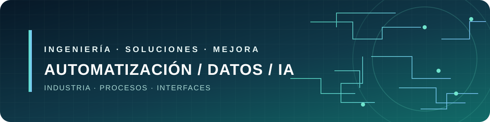

  

<table>
  <tr>
    <td width="68%" valign="middle">
      <h1>Christian Alejandro Pineda Torres</h1>
      
<strong>Ingeniero Electrónico</strong> · Estudiante de <strong>Maestría en Ingeniería</strong> 📍 Bogotá, Colombia

      
Mi perfil conecta la automatización industrial y de procesos con el diseño de interfaces gráficas y la inteligencia artificial. También me interesan la gestión de procesos, el análisis de datos y el aseguramiento de la calidad.

      

    </td>
    <td width="32%" align="center" valign="middle">
      
    </td>
  </tr>
</table>

## Enfoque profesional

<table>
  <tr>
    <td width="50%" valign="top"><h3>⚙️ Automatización</h3>
Automatización industrial y de procesos.
</td>
    <td width="50%" valign="top"><h3>🧩 Interfaces e IA</h3>
Diseño de interfaces gráficas (GUI) e inteligencia artificial.
</td>
  </tr>
  <tr>
    <td width="50%" valign="top"><h3>📊 Procesos y datos</h3>
Gestión de procesos y análisis de datos.
</td>
    <td width="50%" valign="top"><h3>✅ Calidad</h3>
Aseguramiento de la calidad.
</td>
  </tr>
</table>

<strong>Conectemos</strong> Consulta mi trayectoria y experiencia en <a href="https://www.linkedin.com/in/christian-alejandro-pineda-torres-028b43280/">LinkedIn</a>.

